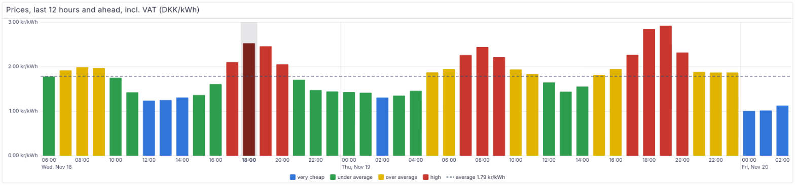
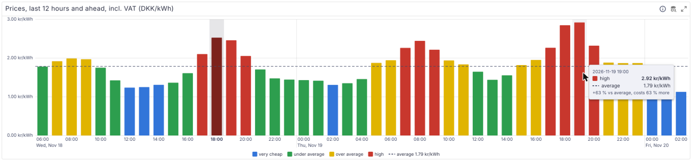

# perses-plugin-pricebars

A [Perses](https://perses.dev) panel plugin, `PriceBarChart`: one bar per hour (or any category),
coloured by how its value compares with the average of the shown bars, with a dashed average line
and the current hour highlighted. Made for electricity spot prices: "which hours are cheap, and
where are we now?"

```promql
# one series per hour, labelled start="2026-11-18 17:00" (local time)
sum by (start) (elpris_hour_dkk_per_kwh @ end()) * 1.25
```

<picture>
  <source media="(prefers-color-scheme: dark)" srcset="docs/images/price-bars-dark.png">
  
</picture>

## Supported versions

| Plugin | Perses  | Status              |
| ------ | ------- | ------------------- |
| 0.1.x  | v0.55.x | Tested with v0.55.1 |

## What it does

- **One bar per category.** The last value of every series, grouped by `categoryLabel` (default
  `start`) and summed per value, sorted by it. Every query of the panel contributes.
- **Bands.** Each bar takes the first band whose `upTo` (percent of the average of all shown bars)
  it does not exceed. Defaults: very cheap up to 75 %, under average up to 100 %, over average up to
  115 %, high above.
- **Average line.** A dashed line at the average. It does not react to the mouse; the average shows
  in the legend and in every bar's tooltip, with how much that hour saves or costs against
  it ("−25 % vs average, saves 25 %").

  <picture>
    <source media="(prefers-color-scheme: dark)" srcset="docs/images/price-bars-tooltip-dark.png">
    
  </picture>

- **Current hour.** When the category is a local time (`YYYY-MM-DD HH:mm`), the bar whose hour holds
  the viewer's current time is drawn darker on a light background column. The hovered bar gets a
  fainter column of the same kind.
- **Full width.** The bars use the whole panel; day changes get a divider and a date.

## Options

```yaml
kind: PriceBarChart
spec:
  categoryLabel: start
  bands:
    - { upTo: 75, color: "#3274d9", label: very cheap }
    - { upTo: 100, color: "#2e9e4f", label: under average }
    - { upTo: 115, color: "#e0b400", label: over average }
    - { color: "#c8372d", label: high }
  average: { show: true, label: average }
  highlightCurrent: true
  format: { unit: decimal, decimalPlaces: 2 }
  legend: { position: bottom }
```

The schema is `schemas/panels/price-bar-chart/price-bar-chart.cue`.

## Try it locally

`dev/` runs Perses with the plugin, a Prometheus, and a made-up price generator that serves
`elpris_hour_dkk_per_kwh` for 12 hours back and 33 hours ahead, with a cheap night, a morning and an
evening peak. The screenshots above come from it. It needs `podman compose` or `docker compose`.

```bash
npm ci && npm run build && percli plugin build
cp PriceBars-*.tar.gz dev/archive/
podman compose -f dev/compose.yaml up -d    # PERSES_PORT=... to move it off 18082
```

Open <http://localhost:18082/projects/demo/dashboards/prices>; the bars show after the first scrape,
about 15 seconds. `podman compose -f dev/compose.yaml down` removes it again.

## Install into Perses

Each release publishes `PriceBars-<version>.tar.gz` and a plugin-only OCI image
`ghcr.io/astrona-io/perses-plugin-pricebars:<tag>` with the archive at its root. Mount the image as
a Kubernetes image volume in a directory listed in Perses' `plugin.archive_paths`, or copy the
archive there, and restart Perses.

## Development

See [CONTRIBUTING.md](CONTRIBUTING.md).
